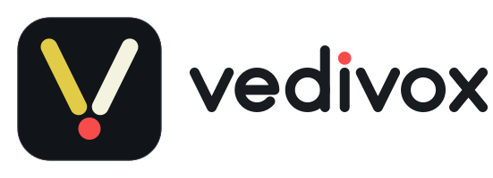
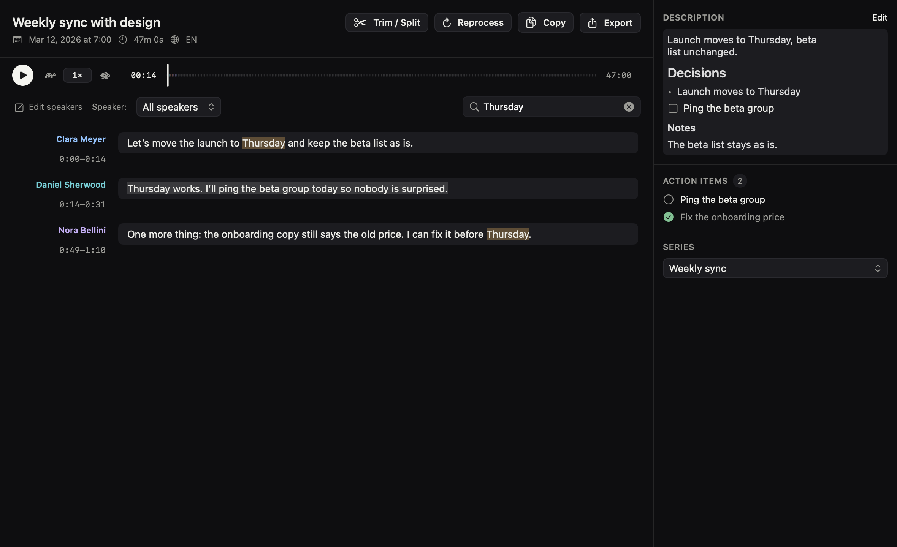
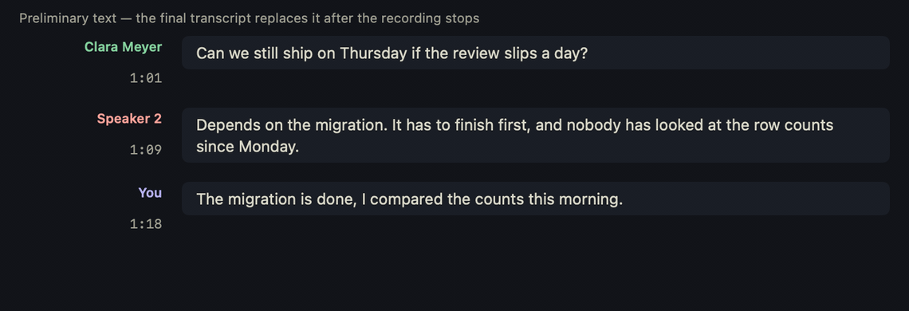
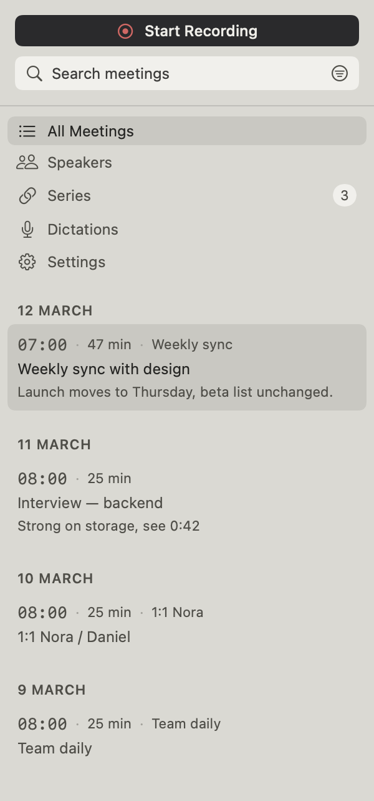
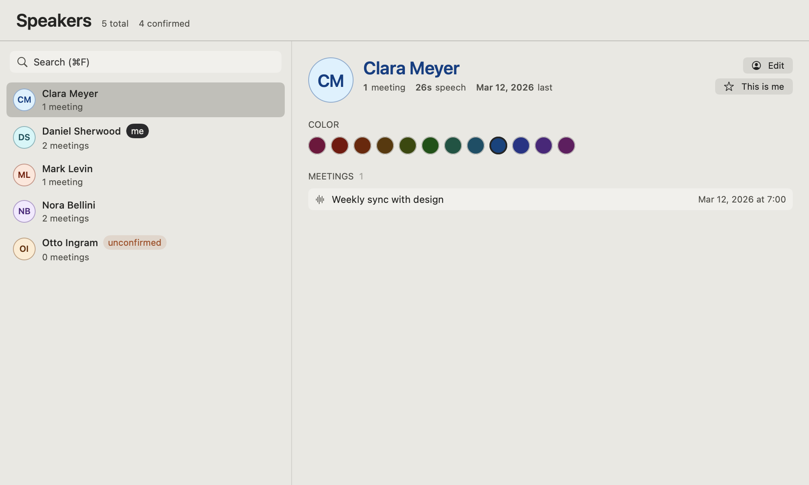

# <picture><source media="(prefers-color-scheme: dark)" srcset="docs/images/vedivox-header-dark.svg"></picture>

[](https://github.com/dimstunt/vedivox/actions/workflows/test.yml)
[](https://github.com/dimstunt/vedivox/stargazers)
[](LICENSE)

A macOS meeting recorder that transcribes and tells speakers apart on your Mac.

If Vedivox helps you, a ⭐ helps others find it.





Vedivox records your microphone and the system audio of a call (Zoom, Google Meet,
Microsoft Teams, Yandex Telemost, anything that plays sound), turns both into a transcript, and labels who said
what. Voices it has met before are recognized by name in later meetings. It
also does push-to-talk dictation into any app, imports existing recordings, and
exposes everything through a command line and an MCP server, so an assistant
such as Claude Code can search and summarize your meetings.

Status: pre-1.0, built for one person's daily use and shared as is. Database
migrations may still break backward compatibility between versions.

## Requirements

- macOS 14.4 or later on Apple Silicon (the models run on the Neural Engine).
- Internet on first launch: the speech models are downloaded once (about 1.2 GB).
  After that, recording, transcription and speaker recognition work offline.
- About 3 GB of free disk for the models and their compiled caches.

Transcription uses NVIDIA Parakeet TDT 0.6B v3, which covers 25 European languages:
Bulgarian, Croatian, Czech, Danish, Dutch, English, Estonian, Finnish, French, German,
Greek, Hungarian, Italian, Latvian, Lithuanian, Maltese, Polish, Portuguese, Romanian,
Russian, Slovak, Slovenian, Spanish, Swedish and Ukrainian (per the model card); other
languages are not supported.

<p>
  
  
</p>

## Install with Homebrew

```bash
brew install --cask dimstunt/tap/vedivox
```

The cask installs `Vedivox.app` and links the `vedivox` CLI and the `vedivox-mcp` server into Homebrew's
`bin`. The Claude Code skills are not part of the cask: they install as a plugin, two commands
under [Command line and MCP](#command-line-and-mcp). Your meetings are never removed by
`brew uninstall --zap`.

## Install from a release zip

Unpack the archive and run `bash install.sh` in it. The full walkthrough —
permissions, the CLI and the Claude Code skills — is in
[docs/INSTALL.md](docs/INSTALL.md).

## Build from source

You need Xcode 26 or later and [XcodeGen](https://github.com/yonaskolb/XcodeGen)
(`brew install xcodegen`).

```bash
make install TEAM=-            # ad-hoc signature, no Apple account needed
make install TEAM=ABCDE12345   # or sign with your own Apple Developer team
```

`make install` builds a Release `Vedivox.app` into `/Applications` and puts `vedivox`
and `vedivox-mcp` into `~/.local/bin`. Without `TEAM` the build signs with the
author's team from `Vedivox/project.yml` when its certificate is in the keychain and
ad hoc otherwise (the Makefile says so in its first line of output). Dependency
versions are pinned by the committed `Package.resolved` files.

With an ad-hoc signature (`TEAM=-`) macOS treats every rebuild as a new app and
asks for the microphone and system-audio permissions again. A real team ID keeps
them across rebuilds.

The same `TEAM=` works for the tests:

```bash
make test TEAM=-        # headless logic suite, the gate
make test-ui TEAM=-     # HUD snapshot tests, needs a full app build
```

`Vedivox/Vedivox.xcodeproj` is generated from `Vedivox/project.yml` (`make generate`); do
not edit it by hand. The benchmark target (`make bench`) and a few recorded
scenarios rely on private recordings that are not in this repository; those
tests skip themselves.

`make dist` packs `Vedivox.app`, the CLI and the docs into a zip for another Mac.
`make dist-notarized DEVELOPER_ID="Developer ID Application: …"` signs and
notarizes that zip (see the comment in the `Makefile`); without `DEVELOPER_ID` it takes
the Developer ID certificate from the keychain.

## Command line and MCP

`vedivox` reads the same database as the app and sends actions to the running app
over a local Unix socket: `vedivox list`, `vedivox show <id>`, `vedivox transcript <id>`,
`vedivox search <query>`, `vedivox speakers`, `vedivox import <file|url>`,
`vedivox transcribe <file|url>`, `vedivox reprocess <id> --yes`, `vedivox record start|stop`,
`vedivox live` (the text of the meeting being recorded right now),
`vedivox meeting split|trim|merge|undo` (cut a long recording into calls, join a call recorded in parts),
and editing commands for speakers, series, marks and segments. The reading commands,
`transcribe`, `live`, `record`, `meeting split|trim|merge|undo|delete`, `audio compact` and
`feedback` take `--json`; the rest print text only. `vedivox --help` lists them all.
Ready-made Claude Code skills live in
[skills/vedivox](skills/vedivox), [skills/vedivox-live](skills/vedivox-live) (help during a
call) and [skills/vedivox-enrich](skills/vedivox-enrich) (a title and a timestamped description
for a meeting). This repository is also a Claude Code plugin marketplace, so the skills install
and update as a plugin. In Claude Code:

```
/plugin marketplace add dimstunt/vedivox
/plugin install vedivox@vedivox
```

They are then `/vedivox:vedivox`, `/vedivox:vedivox-live` and `/vedivox:vedivox-enrich`, and
`/plugin marketplace update vedivox` brings the newer ones after a release. `install.sh` copies
the same skills into `~/.claude/skills` instead; use one way or the other.

`vedivox-mcp` is a Model Context Protocol server over stdio. It lists, reads and searches
meetings (the live transcript of a recording too), imports files and YouTube links,
reprocesses, splits, trims and merges meetings and undoes those edits, renames and merges
speakers, reassigns lines, sets a meeting's title, description and series, creates series, and
adds and removes excluded intervals. It does not record, and has no counterpart of
`transcribe`, `status`, `queue`, `audio compact`, `feedback`, `mute-debug`, `meeting delete`,
`speaker detach|delete` or `series set|merge|delete|apply-rules`. Its 22 tools:
`list_meetings`, `get_meeting`, `get_transcript`, `get_live_transcript`, `search_transcripts`,
`list_speakers`, `update_speaker`, `merge_speakers`, `update_meeting`, `update_segment`,
`reprocess_meeting`, `split_meeting`, `trim_meeting`, `merge_meetings`, `undo_meeting_edit`,
`import_file`, `import_youtube`, `list_series`, `create_series`, `mark_excluded`, `unmark`,
`list_marks`.

Point an MCP client at the binary by its full path:

```json
{
  "mcpServers": {
    "vedivox": { "command": "/Users/you/.local/bin/vedivox-mcp" }
  }
}
```

That is `~/.local/bin/vedivox-mcp` after `install.sh` or `make install`, and
`/opt/homebrew/bin/vedivox-mcp` (Homebrew's `bin`) after the cask. With Claude Code the
CLI plus the skill is usually enough, and MCP is optional.

Who can drive the app: any process running as your macOS user, not just `vedivox`
and `vedivox-mcp`. The socket does not check which program connects; other users on
the Mac cannot reach it. Such a process can start a recording and read the
audio, so Vedivox shows a notification, "Recording started from the command line",
whenever a recording is started through the socket. See
[SECURITY.md](SECURITY.md).

## Privacy

Recording, transcription and speaker recognition run on the Mac with Core ML.
Audio, transcripts, voice profiles and the database stay in
`~/Library/Application Support/Vedivox/`. There is no account, telemetry, analytics,
crash reporting or auto-install, and the code calls no cloud or LLM API. The MCP
server speaks stdio and the app's control channel is a Unix socket readable
only by you; nothing listens on the network.

The exceptions, so the claim stays honest:

- On first launch (and again if the model cache is cleared) the speech models
  are downloaded from Hugging Face over HTTPS. After that Vedivox works offline.
- `vedivox import <url>` and `vedivox transcribe <url>` run the `yt-dlp` you installed
  yourself, which contacts the video site.
- Once a day Vedivox asks the GitHub API for its latest release, to tell you when a
  newer version is out. It is one anonymous GET; nothing about you or your
  meetings is sent, and nothing is downloaded or installed. Turn it off in
  Settings → About.
- `vedivox feedback` writes a zip with logs to your Desktop. Nothing is sent, but
  the logs contain meeting titles, speaker names and file paths — read it before
  you share it.
- Calendar access uses the local macOS calendar store. Reading the browser's
  tabs (to notice a Google Meet or Yandex Telemost call) happens locally through Apple Events.
- The app is not sandboxed, so all of the above is a property of the code, not
  something macOS enforces.

## Recording other people

In many countries and US states, recording a conversation requires the consent
of everyone in it, sometimes announced in advance. Vedivox does not tell anyone
that it is recording: it shows its own recording indicator on your Mac and
nothing else, and it records whatever your Mac plays and hears. Knowing the
rules where you and the other people are, and asking for consent, is your
responsibility. This is not legal advice.

## Documentation

- [docs/GUIDE.md](docs/GUIDE.md) — the non-obvious parts of the UI: hotkeys,
  modifier clicks, settings files. Also in the app under Help → Vedivox Guide.
- [CHANGELOG.md](CHANGELOG.md) — what changed in each version.
- [docs/INSTALL.md](docs/INSTALL.md) — installing a release zip.

## Acknowledgements

Vedivox is glue around other people's work.

Libraries:

| Library | Licence | Used in |
|---|---|---|
| [FluidAudio](https://github.com/FluidInference/FluidAudio) (includes fastcluster, BSD-2-Clause, and a port of VBx, Apache-2.0) | Apache-2.0 | app |
| [GRDB.swift](https://github.com/groue/GRDB.swift) | MIT | app, CLI, MCP server |
| [KeyboardShortcuts](https://github.com/sindresorhus/KeyboardShortcuts) | MIT | app |
| [swift-argument-parser](https://github.com/apple/swift-argument-parser) | Apache-2.0 with Runtime Library Exception | CLI |
| [swift-snapshot-testing](https://github.com/pointfreeco/swift-snapshot-testing) and its dependencies | MIT; swift-syntax is Apache-2.0 | tests only |

Models. None are stored in this repository or in the app bundle; FluidAudio
downloads them at run time from the Fluid Inference repositories on Hugging
Face. All of them are Core ML conversions, that is, modified versions of the
originals.

| Used for | Downloaded from | Original model | Licence |
|---|---|---|---|
| Transcription | [FluidInference/parakeet-tdt-0.6b-v3-coreml](https://huggingface.co/FluidInference/parakeet-tdt-0.6b-v3-coreml) | NVIDIA [parakeet-tdt-0.6b-v3](https://huggingface.co/nvidia/parakeet-tdt-0.6b-v3) | [CC-BY-4.0](https://creativecommons.org/licenses/by/4.0/) |
| Speaker diarization and voice embeddings | [FluidInference/speaker-diarization-coreml](https://huggingface.co/FluidInference/speaker-diarization-coreml) | [pyannote speaker-diarization-community-1](https://huggingface.co/pyannote/speaker-diarization-community-1), with WeSpeaker embeddings and PLDA from BUT Speech@FIT; the legacy path uses pyannote segmentation-3.0 (MIT, © CNRS) and wespeaker-voxceleb-resnet34-LM | CC-BY-4.0 |
| Live text while dictating | [FluidInference/Nemotron-3.5-ASR-Streaming-Multilingual-0.6b-CoreML](https://huggingface.co/FluidInference/Nemotron-3.5-ASR-Streaming-Multilingual-0.6b-CoreML) | NVIDIA nemotron-3.5-asr-streaming-0.6b | [OpenMDW-1.1](https://openmdw.ai/license/1-1/) |

Thanks to NVIDIA, the pyannote and WeSpeaker authors, BUT Speech@FIT and Fluid
Inference. The licences above are those stated on the model cards in
November 2026; the cards are the authority if they change.

The licences and notices of everything built into the app, the CLI and the MCP server, in
full, are in [THIRD_PARTY_NOTICES.md](THIRD_PARTY_NOTICES.md), which also ships in the
release zip.

URL import relies on [yt-dlp](https://github.com/yt-dlp/yt-dlp) and
[ffmpeg](https://ffmpeg.org), which Vedivox does not ship: install them yourself
(`brew install yt-dlp ffmpeg`) if you want that feature.

## Licence

Vedivox is free software under the [GNU General Public License, version 3 or any
later version](LICENSE) (GPL-3.0-or-later). © 2026 Dmitrii Cherkashin

Issues, ideas and pull requests are welcome; a pull request is merged under the
contributor licence agreement in [CONTRIBUTING.md](CONTRIBUTING.md).
